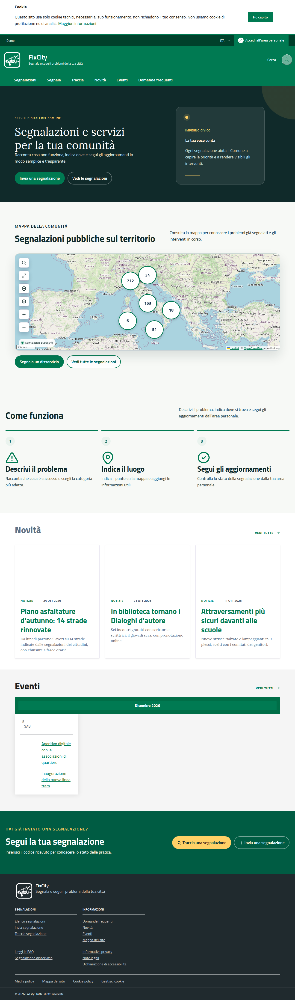

> Screenshot reale del front office FixCity, verificato il 23 novembre 2026. Per questo modulo è una superficie condivisa: il manuale non attribuisce al modulo una UI propria se non documentata dalle fonti.

# Modulo Mobile

## Scopo

Mobile fornisce il contenitore NativePHP, contratti e componenti per applicazioni
mobile. Il modulo resta agnostico rispetto all'applicazione host; le route web,
API e mobile dichiarate dal modulo sono vuote e il front office usa Folio/Volt.

## Matrice attori

| Attore | Accesso o responsabilità verificata |
|---|---|
| Ospite | Il README documenta consultazione mappa, elenco/dettaglio segnalazioni, filtro, FAQ e segnalazione anonima. È un flusso documentato come acceptance criteria, non una verifica runtime. |
| Utente autenticato | Il README documenta mappa personalizzata, creazione con camera/GPS, proprie segnalazioni, notifiche, profilo e logout. |
| Gruppo/ruolo | Gli screen nativi verificano i ruoli `operator`, `department_head`, `admin`, `super_admin` per le azioni riservate. |
| Admin | Il pannello Filament Mobile espone dashboard, resource e widget sotto il percorso `Mobile/admin`; la pagina impostazioni è dichiarata solo super-admin. |
| Super-admin | Può accedere alle impostazioni del tenant Mobile (`enabled`). |
| Operatore | Gli screen nativi lo includono tra i ruoli autorizzati alle operazioni riservate. |

## Flussi reali

1. Il client mobile usa il contenitore NativePHP e gli screen registrati
   dall'host.
2. Il flusso ospite consulta i dati pubblici disponibili tramite il front office
   Folio/Volt.
3. Il flusso autenticato usa Sanctum secondo la documentazione del modulo e
   collega camera, posizione, profilo e notifiche.
4. Gli screen nativi applicano il controllo di ruolo per le operazioni di
   moderazione/gestione previste dal codice.
5. L'amministrazione usa il pannello Filament Mobile; il super-admin configura
   l'abilitazione del modulo per tenant.

## Prerequisiti

- NativePHP installato e configurato dall'applicazione host.
- Screen, gateway e adapter registrati dall'host: Mobile non fornisce un
  prodotto Restaurant completo.
- Folio/Volt e i dati/contratti dell'host disponibili.
- Per i flussi autenticati: autenticazione/token e ruoli applicativi presenti.
- Per camera, GPS, notifiche e offline: capability native e relativo runtime.

## Limiti

- Le route `routes/web.php`, `routes/api.php` e `routes/mobile.php` sono
  intenzionalmente vuote.
- Il contratto GeoJSON citato dalla documentazione è esposto da Fixcity, non da
  Mobile.
- Le tabelle del README sono acceptance criteria e non sostituiscono una prova
  end-to-end su dispositivo.
- Non è presente una policy Mobile autonoma per le Resource: i controlli di ruolo
  rilevati sono negli screen nativi.

## Link a codice/docs

- [README del modulo](README.md)
- [Route web](../routes/web.php)
- [Route API](../routes/api.php)
- [Route mobile](../routes/mobile.php)
- [Screen creazione ticket](../app/Native/Screens/CreateTicketScreen.php)
- [Screen dettaglio ticket](../app/Native/Screens/TicketDetailScreen.php)
- [Pannello amministrativo](../app/Filament/AdminPanelProvider.php)
- [Impostazioni](../app/Filament/Pages/SettingPage.php)

